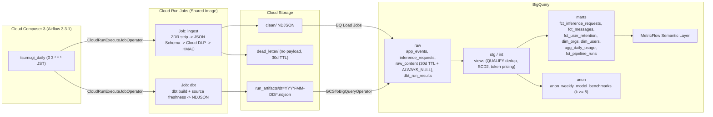

# Tsumugi Analytics Platform

**30-second summary**: An end-to-end, privacy-first analytics platform on Google Cloud
(`asia-northeast1`) for **Tsumugi**, a fictional B2B/B2C LLM chat app and developer API
(`tsumugi-mini`, `tsumugi-pro`). It turns product telemetry and LLM inference logs into
contract-enforced BigQuery marts, an APPI $k$-anonymous benchmark dataset (`k >= 5`), and a
MetricFlow semantic layer—while stripping Zero Data Retention (ZDR) prompts in memory, redacting
non-ZDR text via regional Cloud DLP, and pseudonymizing identifiers with Secret Manager–backed
HMAC-SHA256.

---

## Architecture (`asia-northeast1`)



---

## Review in 5 Minutes

| Evaluation Area | Key Files & Live Evidence |
|---|---|
| **1. Data Modeling & Incremental Design** | [`fct_inference_requests.sql`](dbt/models/marts/fct_inference_requests.sql) (whole-table watermark + 3-day `incremental_predicates` MERGE), [`int_org_history.sql`](dbt/models/intermediate/int_org_history.sql) $\rightarrow$ [`dim_orgs.sql`](dbt/models/marts/dim_orgs.sql) (SCD2), [`fct_user_retention.sql`](dbt/models/marts/fct_user_retention.sql) (D7 cohort eligibility), [`fct_pipeline_runs.sql`](dbt/models/marts/fct_pipeline_runs.sql) (`INFORMATION_SCHEMA.JOBS` observability) |
| **2. LLM Usage & Effective-Dated Cost** | [`tracking_plan/events.yaml`](tracking_plan/events.yaml) (source of truth + codegen), [`int_inference_requests_priced.sql`](dbt/models/intermediate/int_inference_requests_priced.sql) + [`model_pricing.csv`](dbt/seeds/model_pricing.csv) (`NUMERIC` input/cached/output token pricing; failed requests cost `0`) |
| **3. Privacy (APPI / ZDR / DLP / HMAC)** | [`docs/privacy.md`](docs/privacy.md) (APPI 仮名加工情報 / 匿名加工情報 公表事項), [`ingest/pipeline.py`](ingest/pipeline.py) & [`ingest/dlp.py`](ingest/dlp.py) (in-memory ZDR strip before validation/DLP), [`anon_weekly_model_benchmarks.sql`](dbt/models/anon/anon_weekly_model_benchmarks.sql) ($k \ge 5$), [`ingest_stats_dlp.json`](docs/sample_outputs/ingest_stats_dlp.json) (live Cloud DLP recall vs. ground truth) |
| **4. Reproducible Infra & Orchestration** | [`infra/`](infra/) (`bigquery.tf` policy tag + `ALWAYS_NULL` masking, `iam.tf` least-privilege SAs + GitHub WIF bound to `repository_id`, `cloud_run.tf`, `composer.tf`), [`tsumugi_daily.py`](orchestration/dags/tsumugi_daily.py) (Airflow 3 `jst_target_date`, `ALL_DONE` freshness/stats + `ONE_FAILED` leaf watcher) |
| **5. Data Quality & Contracts** | [`_marts__models.yml`](dbt/models/marts/_marts__models.yml) & [`_anon__models.yml`](dbt/models/anon/_anon__models.yml) (enforced contracts), [`assert_request_zdr_matches_org_history.sql`](dbt/tests/assert_request_zdr_matches_org_history.sql), [`assert_late_arrivals_within_lookback.sql`](dbt/tests/assert_late_arrivals_within_lookback.sql), [`assert_anon_k_anonymity.sql`](dbt/tests/assert_anon_k_anonymity.sql), [`test_ingest_privacy.py`](tests/test_ingest_privacy.py) |
| **6. Semantic Layer & Operations** | [`docs/metrics.md`](docs/metrics.md), [`semantic_models.yml`](dbt/models/semantic/semantic_models.yml) & [`metrics.yml`](dbt/models/semantic/metrics.yml), [`metricflow_queries.md`](docs/sample_outputs/metricflow_queries.md) (5 live queries + partition pruning proof), [`docs/architecture.md`](docs/architecture.md), [ADR 0001](docs/adr/0001-what-id-do-at-scale.md), [Runbooks](docs/runbooks/), [`docs/ai-usage.md`](docs/ai-usage.md) |

---

## Quickstart

### Offline (no GCP credentials required)

```bash
make doctor          # check local CLI tools (uv, gcloud, bq, terraform, docker, gitleaks)
make setup           # sync locked Python environments (root + orchestration/)
make demo-offline    # generate synthetic data + run in-memory ingest with regex redactor
make lint test       # ruff, sqlfluff, terraform fmt/validate, schema drift, pytest, dbt parse, MetricFlow, DAG tests, gitleaks
make metrics-explain METRICS=weekly_active_orgs,cost_per_active_user GROUP_BY=metric_time__week
```

### Live GCP (`asia-northeast1`)

```bash
make tf-plan                              # preview Terraform changes against GCS state
make image                                # build & push shared runner image to Artifact Registry
make run-ingest TARGET_DATE=2026-11-18    # execute Cloud Run Job `ingest` (DLP + HMAC -> GCS -> BQ raw)
make run-dbt TARGET_DATE=2026-11-18       # execute Cloud Run Job `dbt` (build prod marts/anon + emit NDJSON stats)
make test-bq                              # create expiring ci_<sha> dataset (24h) and run full dbt build (64/64)
make composer-deploy-dags                 # upload orchestration/dags/tsumugi_daily.py to Composer 3
```

Run `make help` for the full target list.
