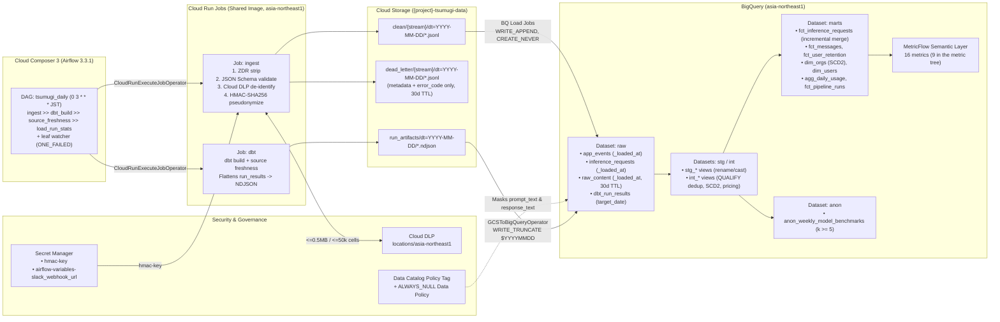

# Architecture (`Tsumugi` Analytics Platform)

`Tsumugi` is a fictional B2B/B2C LLM product offering a multi-platform chat app (`web`, `ios`,
`android`) and a developer API (`tsumugi-mini`, `tsumugi-pro`). This platform turns raw product
events and LLM inference logs into privacy-safe marts and a governed semantic layer on Google Cloud
(`asia-northeast1`).

---

## 1. End-to-End Topology

---

## 2. Key Engineering Decisions

### Single Shared Container Image (`runner`)
Both Cloud Run Jobs (`ingest` and `dbt`) use the same multi-stage image (`Dockerfile`) hosted in
Artifact Registry (`asia-northeast1-docker.pkg.dev/<project>/tsumugi/tsumugi`). Composer overrides
only the container args (`ingest --date <YYYY-MM-DD>` vs.
`dbt build --target prod --artifacts-uri gs://...`). Airflow (`composer-3-airflow-3.3.1`) lives in
a separate `uv` project (`orchestration/`) because Airflow and `dbt-bigquery`/`metricflow` pin
conflicting `protobuf` and `SQLAlchemy` ranges.

### Schema-First Contract & Drift Prevention
`tracking_plan/events.yaml` is the single source of truth for event properties, types, and PII
classifications (`none`, `identifier`, `free_text`). `python -m tracking_plan.codegen` generates:
1. Closed JSON Schemas (`additionalProperties: false`) in `tracking_plan/schemas/` used by
   in-memory ingest validation.
2. BigQuery `TableFieldSchema` JSON files in `tracking_plan/bq_schemas/` consumed directly by
   Terraform (`infra/bigquery.tf`).
`make test` runs `python -m tracking_plan.codegen --check` and `tests/test_infra.py` so schema
drift fails CI before any deployment.

### Incremental `MERGE` & Late-Arrival Handling in BigQuery
- **Deduplication before `MERGE`**: The generator injects ~1% duplicate deliveries and up to
  2-day late arrivals. BigQuery `MERGE` raises a runtime error if multiple source rows match a
  single target row, so `int_app_events_deduped` and `int_inference_requests_deduped` deduplicate
  with `QUALIFY ROW_NUMBER() OVER (PARTITION BY <id> ORDER BY _loaded_at DESC) = 1`.
- **Whole-table watermark, 3-day destination predicate**:
  - `fct_inference_requests` filters new source rows using the maximum `_loaded_at` across the
    *entire* target table (`WHERE existing.event_date >= DATE('2000-01-01')` satisfies
    `require_partition_filter = true` while scanning only one column). A recent-partitions-only
    watermark would turn `NULL` after a $>3$-day pipeline outage and silently stop loading.
  - `incremental_predicates` restricts the `MERGE` target scan to the last 3 JST days
    (`DBT_INTERNAL_DEST.event_date >= date_sub(current_date('Asia/Tokyo'), interval 3 day)`),
    which exceeds the 2-day maximum late arrival (verified by singular test
    `assert_late_arrivals_within_lookback`).

### Effective-Dated Token Pricing & SCD2 Organization History
- `org_changed` events (`created`, `plan_changed`, `zdr_changed`) are turned into a Type-2
  slowly changing dimension (`int_org_history` $\rightarrow$ `dim_orgs`) using
  `valid_from = changed_at` and `valid_to = LEAD(changed_at) OVER (PARTITION BY org_id ORDER BY changed_at)`.
- `int_inference_requests_priced` joins each request's `event_ts` against both `dim_orgs` and the
  effective-dated `model_pricing` seed using `NUMERIC` arithmetic (`cost_usd = 0` on
  `status = 'error'`).
- A cross-source singular test (`assert_request_zdr_matches_org_history`) asserts that the `zdr`
  boolean stamped on every inference request matches the organization's SCD2 ZDR state at
  `event_ts`.

---

## 3. Least-Privilege IAM Matrix (`infra/iam.tf` & `infra/bigquery.tf`)

| Principal | Project / Service Roles | Resource-Scoped Roles | `raw.raw_content` Access |
|---|---|---|---|
| `sa-ingest` | `roles/dlp.user`, `roles/bigquery.jobUser` | `secretAccessor` on `hmac-key`; `objectAdmin` on data bucket; `bigquery.dataEditor` on `raw` | Write-only via load job |
| `sa-dbt` | `roles/bigquery.jobUser`, `roles/bigquery.resourceViewer` | `objectAdmin` on data bucket; `bigquery.dataViewer` on `raw`; `bigquery.dataEditor` on `stg`, `int`, `marts`, `anon` | `maskedReader` (`ALWAYS_NULL`); never queried by dbt |
| `sa-composer` | `roles/composer.worker`, `roles/run.jobsExecutorWithOverrides`, `roles/run.viewer` (`run.operations.get` LRO polling), `roles/bigquery.jobUser` | `secretAccessor` on `airflow-variables-slack_webhook_url`; `objectViewer` on data bucket; `bigquery.dataEditor` on table `raw.dbt_run_results` only, plus a custom role on `raw` with only `bigquery.tables.create` (load jobs check it at dataset level) | None |
| `sa-ci-wif` | `roles/bigquery.user`, `roles/bigquery.resourceViewer` | WIF `workloadIdentityUser` bound to numeric `github_repository_id`; `bigquery.dataViewer` on `raw` | `maskedReader` (`ALWAYS_NULL`) |

---

## 4. Cost Controls ($50/month Budget)

- **BigQuery load jobs only**: Ingest and Composer `load_run_stats` use batch load jobs (free
  tier), never streaming inserts.
- **Query guardrails**: All dbt profiles set `maximum_bytes_billed: 1000000000` (1 GB) and
  `job_execution_timeout_seconds: 300`. A full 61-node `dbt build` bills **575.7 MB (~$0.0033)**
  as recorded in `marts.fct_pipeline_runs`.
- **Storage lifecycles**: `raw.raw_content` partitions and `clean/raw_content/` + `dead_letter/`
  GCS objects expire after 30 days. `dev_tsumugi` tables expire after 7 days; CI `ci_<sha>`
  datasets expire after 24 hours.
- **Ephemeral Composer 3**: Gated behind `var.enable_composer = false` in Terraform and destroyed
  immediately after live DAG verification.
